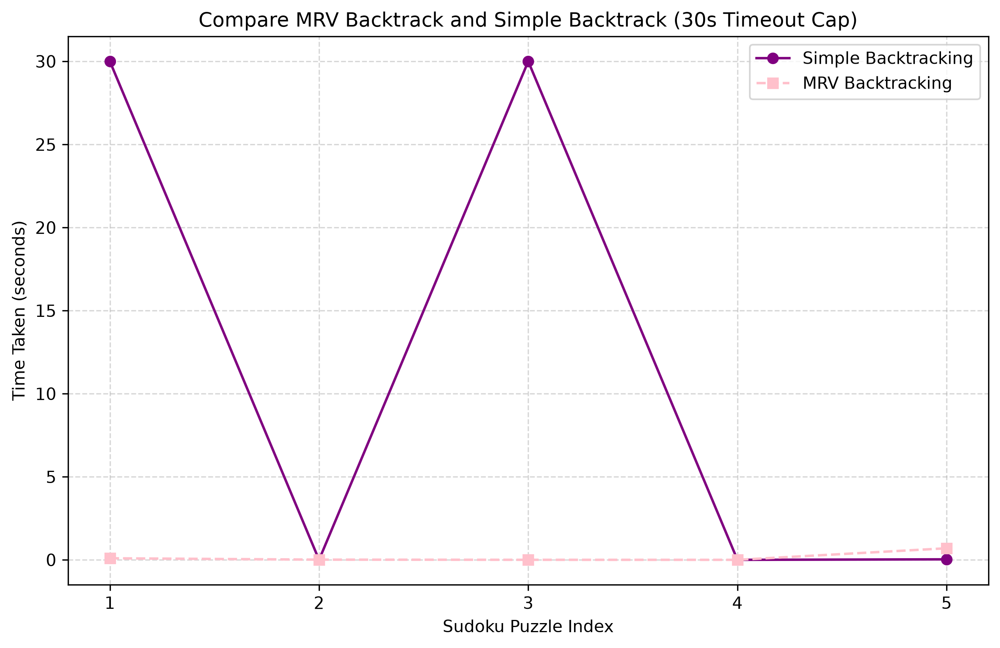

# Constraint Satisfaction Problems (CSP) & Backtracking Solvers

From-scratch Python implementations of classic **Constraint Satisfaction Problems (CSP)** and combinatorial search algorithms, featuring a runtime comparison between **Chronological Backtracking** and the **Minimum Remaining Values (MRV)** variable-ordering heuristic.

## Implemented Problems & Algorithms

1. **Sudoku CSP Solver & MRV Benchmark (`sudoku.py`, `benchmark_sudoku.py`):**
   * **Chronological Backtracking:** Baseline recursive depth-first search assigning values sequentially.
   * **MRV Heuristic Backtracking:** Intelligent variable selection that dynamically chooses the unassigned cell with the fewest legal values remaining, drastically reducing the search tree branching factor.
2. **N-Queens Solver (`8queen.py`):**
   * Recursive backtracking solver placing $N$ queens on an $N \times N$ chessboard without row, column, or diagonal conflicts.
3. **Magic Square Generator (`magic_square.py`):**
   * Constructive algorithm generating odd-order $n \times n$ magic squares using the Siamese method.

---

## Experimental Results: Simple Backtracking vs. MRV Heuristic

Runtime comparison across 5 randomly generated $9 \times 9$ Sudoku puzzles (with a 30-second timeout cap for unsolvable instances):



### Benchmark Log Summary

| Puzzle Instance | Simple Backtracking | MRV Backtracking | Status |
| :--- | :---: | :---: | :--- |
| **Puzzle 1** | `30.0000s` (Timeout) | **`0.0947s`** | Unsolvable (MRV detected dead-end >300x faster) |
| **Puzzle 2** | **`0.0016s`** | `0.0119s` | Solved |
| **Puzzle 3** | `30.0000s` (Timeout) | **`0.0021s`** | Unsolvable (MRV detected dead-end >14,000x faster) |
| **Puzzle 4** | **`0.0004s`** | `0.0007s` | Unsolvable |
| **Puzzle 5** | **`0.0307s`** | `0.6967s` | Unsolvable |

> **Key Takeaway:** While Simple Backtracking can be marginally faster on trivial instances due to lower per-step overhead (Puzzle 2), the **MRV heuristic** dramatically outperforms on constrained/unsolvable boards by pruning dead-end search branches early (Puzzles 1 & 3).

---

## How to Run

```bash
pip install matplotlib
python benchmark_sudoku.py
